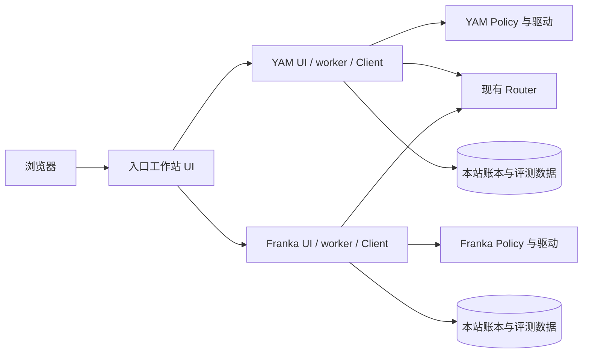

# Colosseum Unified UI：YAM / Franka 统一评测工作站

一个入口选择 YAM 和 Franka，每台机器人保留独立页面、评测状态和请求目标。操作者可以启动一台后切换到另一台；切换选机不会停止另一台已运行的评测。

本仓库提供 UI、工作站适配和网关。运行时仍依赖各工作站原有的 Colosseum Client、机器人驱动、Policy、Router 与配置，不包含完整设备环境或 Router 服务端。

## 1. 发布内容与当前边界

这是脱敏源码版本。配置使用 `/path/to/...` 和 `*.example.invalid` 占位符；它们不是可直接连接的实际地址，必须在本地配置中替换。运行时所需的回环地址和监听所有网卡的地址只表示网络行为，不包含现场网络信息。

- 包含完整 UI/网关/worker 运行源码、配置模板、测试和开发工具。
- 不包含现场 IP、主机用户名、机器绝对路径、机构与评测标识、个人邮箱、真实密钥、历史截图或部署报告。
- 工作站登记、独立页面、固定请求前缀和草稿隔离已实现，已有两个回环模拟站验证。
- 真实双机并行及 Router 跨工作站隔离尚未验收，尤其是新评测前 `POST /reset` 的作用范围。
- Franka 新 UI 已在单站部署并使用；YAM 新 UI 仍停用。真实双机并行与 Router 隔离仍未验收。取得源码不代表设备已经配置或服务应自动启动。

不同 institution、不同页面、不同本机数据库不能单独证明 Router 已隔离。模拟并发通过也不能替代实机验收。

## 2. 架构和地址如何填写



每个 UI 进程只管理自己的本机 worker，worker 在原 Client Python 环境运行。远端操作由网关转发，不在入口站导入远端机器人驱动。

| 地址类别 | README 中的占位名称 | 用途 |
| --- | --- | --- |
| YAM Client UI | `yam-client.example.invalid:8772` | 可作为统一入口 |
| Franka Client UI | `franka-client.example.invalid:8772` | 选机时登记的远端 UI |
| Policy 服务 | 在原 Client/Policy 配置中填写 | 推理服务，不能当作 UI 地址登记 |
| 机器人 RPC | 在 Franka 本地工作站配置中填写 | 原机器人控制服务 |
| 原 Web 后台 | 本机 `http://localhost:8080` | 复用维护和翻译能力 |

网关登记必须使用 **运行 Client 的工作站 UI 地址**，不要填写 Policy 主机或机器人控制器地址。默认新 UI 端口建议使用 `8772`；旧 UI 端口示例为 `8080`，均按实际配置调整。

## 3. 目录说明

| 路径 | 职责 |
| --- | --- |
| `app.py`、`bridge.py`、`worker.py` | HTTP/WS、进程通信、Client 环境入口 |
| `station_hub.py`、`hub.html`、`hub.js` | 身份、登记、选机、转发、汇总统计 |
| `eval_gui.html`、`station.js`、`i18n.js` | 设置、录制、回放评分、统计、中英文 |
| `station.py`、`runtime.py`、`legacy_host.py` | 配置、原评测流程、旧维护后台适配 |
| `store.py`、`submission.py`、`client_job.py` | 账本、提交确认、原 Client 导出和上传 |
| `task_annotations.py`、`scene_reference.py`、`error_recovery.py` | 任务难度、临时初始摆放照片、失败轮次清理 |
| `configs/` | 需要按现场填写的无凭据模板 |
| `upstream/` | 已脱敏的 UI/录制/回放参考代码；哈希对应这些副本 |
| `tests/` | 独立单元测试、依赖原 Client 的契约测试、浏览器测试 |
| `validation/` | 合成测试视频和脱敏测试基线源码，不含现场截图/报告 |
| `tools/` | 生成、检查和历史补丁工具 |

历史补丁脚本中的路径也已改成占位符。它们不是通用安装器，不应在新环境直接执行。生成工具依赖相邻 Client 源码，重新生成后须再次执行隐私检查。

## 4. 安装前提和依赖

### 4.1 需要已有的组件

- Linux 实机工作站；GUI 要求 Python 3.10 或更高版本。
- 可用的原 Client Python 环境、对应 Client 源码、驱动、相机/机器人配置及 Router 凭据。Client 自己的 Python 版本要求可能高于 GUI。
- 原 Web 后台代码及其 Python 环境，用于原有 Policy、CAN、Docker 等维护能力。
- 支持 iframe、WebSocket、视频和浏览器存储的浏览器；入口工作站须能访问远端 UI。
- 当前 UI 无独立登录认证，部署在已有访问控制的实验室网络内。

安装 GUI 依赖不会安装或配置 Client、机器人驱动或 Policy。不要把 GUI 环境作为原 Client 环境使用。

### 4.2 获取代码并创建 GUI 环境

先配置个人 GitHub 访问权限，不把 token 写在 URL 中。

```bash
git clone https://github.com/mayatutu/colosseum-unified-ui.git
cd colosseum-unified-ui
python3 -m venv .venv-gui
.venv-gui/bin/python -m pip install -r requirements-gui.txt
.venv-gui/bin/python -m pip check
```

安装命令会下载依赖；在获准准备环境后运行。已有候选目录应先保存其代码、配置与数据，再制定升级方案，不能整目录覆盖。

运行依赖见 [requirements-gui.txt](requirements-gui.txt)：FastAPI、uvicorn、PyYAML、websockets。运行网页无需 Node；浏览器测试才需要 Node/Playwright。

## 5. 配置自己的工作站

只在本机创建私有配置，Git 忽略 `configs/*.local.yaml`：

```bash
# YAM 工作站
cp configs/yam.yaml configs/yam.local.yaml
# Franka 工作站
cp configs/franka.yaml configs/franka.local.yaml
```

| 配置项 | 如何填写 |
| --- | --- |
| `robot` | `yam` 或 `franka`，与原 Client 配置一致 |
| `client_root` | 已有 Client 根目录，包含 `src/` |
| `client_python` | 原 Client 环境的 Python；不要解析软链接后改填系统 Python |
| `robot_config` | 本机原机器人 YAML，其真实凭据继续留在本机 |
| `database` | 独立统计账本；模板使用 `../data/yam.sqlite3` 或 `../data/franka.sqlite3` |
| `display_name` | 可选初始显示名；后续通过选机窗口编辑 |
| `people` | 人员选项，与旧后台人员名单和账本人员合并 |
| `feedback_generation_enabled` | 默认 `false`，控制可选 AI 总评整理 |
| `maintenance.root` / `maintenance.python` | 旧 Web 代码目录和它自己的 Python |
| `maintenance.url` | 旧 Web 的本机地址，模板为 `http://localhost:8080` |
| `policy_config` | YAM 原 Policy 配置，用于读取实际模型服务设置 |
| `robot_rpc` | Franka 原机器人 RPC 端点，必须替换占位地址 |

顶层相对文件路径以工作站 YAML 所在目录为基准；维护后台路径建议填绝对路径。原 Client 的 `evaluation_dir` 等字段仍按 Client 自己的规则解析。

不要把一台工作站的身份数据库、统计账本或私有机器人 YAML 复制给另一台。不要修改模板后直接提交真实地址，始终使用 `.local.yaml`。

### 只检查路径

```bash
.venv-gui/bin/python worker.py --station configs/yam.local.yaml --inspect
# Franka 改用 configs/franka.local.yaml
```

此命令只读取配置、检查目录/Python/机器人 YAML 是否存在，不导入 Runtime、不启动服务或机器人。存在性检查成功仍不证明依赖、驱动和设备已可用。

## 6. 启动、停止与回退

**以下命令只供获得服务操作授权后执行。** 启动 GUI 会启动 worker，维护适配还可能调用旧后台生命周期逻辑；它不等于打开静态页面。

### 6.1 启动

在相应工作站的源码目录中运行其一：

```bash
# YAM
.venv-gui/bin/python app.py --station configs/yam.local.yaml --host 0.0.0.0 --port 8772
# Franka
.venv-gui/bin/python app.py --station configs/franka.local.yaml --host 0.0.0.0 --port 8772
```

`0.0.0.0` 表示监听本机所有网卡，不是某台设备的 IP。浏览器使用本机实际主机名访问 `/`，单站布局入口为 `/station`。`app.py` 默认只监听本机回环接口和端口 `8770`，网络访问必须显式选择绑定参数。

`bash start-yam.sh 8772` / `bash start-franka.sh 8772` 固定读取各自模板 YAML，不会选择 `.local.yaml`；采用私有配置时使用上面的显式启动命令。

YAM 优先复用运行中的旧 Web；旧 Web 不可用时可能加载旧后台，执行其 Policy 自动启动和 watchdog。Franka 原启动以健康检查为主；手动恢复仍属真实服务操作。仓库没有设置自动开机启动。

Franka 早期单站候选包不含当前网关兼容组件。接入前须安装兼容源码和 GUI 环境，不能仅因目录已存在就认为可接入。

### 6.2 身份检查

在服务已由操作者启动后执行：

```bash
curl --fail http://localhost:8772/api/station-info
```

响应含持久 UUID、机器人类型、名称和 `protocol: 1`。身份接口不会创建机器人。不要用设备检查、录制或 Router `/reset` 替代身份查询。

### 6.3 停止或回到原 UI

1. 完成或停止正在进行的评测，等待录制、保存和归位结束，确认没有预览或提交任务。
2. 前台启动的 UI 在其终端用 `Ctrl+C` 结束；后台实例先核对实际命令和进程归属再停止，不照抄历史 PID。
3. 确认新 UI/worker 退出后回到原 Web 入口，保留新 UI 的账本、记录与备份。
4. 旧 Web 托管的 Policy 保持原生命周期；若新 UI 自行托管了 YAM Policy，退出时会清理自己管理的服务，须按实际归属处理。

软件停止会走原 Client 收尾与可能的归位，不等同于物理急停。浏览器关闭、刷新或切换也不是停止机器人方式。

## 7. 选机、页面隔离和并行操作

1. 打开入口站 `/`，在顶部查看在线、运行、待操作或待评分状态。
2. 点击添加机器人，填写名称和远端 **Client UI** 的本地主机地址。不要把真实地址提交回本仓库。
3. 登记只保存名单并 GET 身份/状态；未启动的远端显示离线，不会自动安装或启动。
4. 新打开的远端默认进入设置页，核对机器人和状态后再操作。
5. 一台开始评测后可以切到另一台；每站 iframe 保留，后端继续处理自己的任务。
6. 顶部提示某站等待人员操作时，切回该站完成它的确认。

HTTP、WebSocket、相机图和回放地址通过 `/s/{登记编号}/` 固定到工作站。远端失败不会转给本机，写请求不自动重试。切换只隐藏页面并暂停隐藏页的回放视频，不发送停止/复位命令。

首次打开本机页面时，`#record` 可直接进入录制页；空闲录制页可能自动开启相机预览。纯页面审阅应停留设置或统计页。

各站独立限制一组未完成评测，同一操作者可以在两站操作。没有新增跨站人员占用锁，也没有锁住旧 UI/CLI；同一机器人应由一个控制入口操作。真正同时运行两台前，必须确认 Router 隔离和实机验收条件。

### 工作站身份

`workstations.sqlite3` 保存本站 UUID、名单和已识别的远端 UUID。地址修改后必须仍是同一身份，检测到其他机器会拒绝操作。保留数据库可保留本站身份；创建全新工作站时不要复制该库。

## 8. 日常评测和统计

### 设置

核对当前站名、机器人、人员和连接状态。设备检查、CAN 恢复、Policy 或 Docker 重启会进入真实系统，应按当次授权执行。设置默认灰色锁定，可解锁后保存，没有管理员密码。

YAM 的模型密钥覆盖写入本机 `data/llm-settings.json`，不改原机器人 YAML。Franka 密钥继续由 Policy 主机管理，UI 仅保留提供商选择。

### 录制

1. 选择人员、填写任务指令、场景、最大步数。新建时固定人员归属，恢复中断组沿用原归属。
2. 当前站有未完成组时，先完成它；报错轮次按下述“重开一轮”流程清理。
3. 点击开始，按原 Client 提示准备场景并分别确认 A/B。
4. 查看模型名、执行侧、状态、日志、画面和步数；结束一侧后等待保存及归位，再继续。
5. A/B 录制完成后进入回放评分。

Franka 首次确认摆放时保存左、右相机各一张初始位置参考图，B 侧摆放时展示，便于复位。照片仅留在本机，不进入 LeRobot 数据集；两侧录制完成或该轮被清理后删除。抓图失败会保留确认框并显示原因。

“提前结束当前模型”保留本侧录像并进入正常收尾：A 结束后继续 B，B 结束后进入评分；控制器真实报错仍进入错误流程。它不是物理急停。

### 报错后重开一轮

点击“重开一轮”会清理失败轮次的本地 A/B 录像、参考图和预览缓存，并关闭其本地待处理记录；保留诊断清单和日志。清理完成后返回空白任务表单，清空旧指令、场景、恢复选择和草稿，保留人员。无需为失败轮次评分或填写放弃原因。

此操作不重试旧任务、不自动启动上一任务、不单独向 Router 请求放弃。只有重新填写任务并点击“开始评测”后，才由原 Client 执行正常的新任务流程（包含 `/reset` 和 `/next`）。已提交或正在处理的记录受保护，不能通过此路径删除。清理数据不会修复控制器、Policy 或网络故障，应先根据错误恢复相应设备。

检查未就绪时界面仍可能询问是否继续，这不是就绪证明。Policy 进入保持姿态后 Client 可能继续计步，不能仅凭步数判断仍有有效动作。

### 回放、评分和提交

- 查看 A/B 模型与多路回放；支持播放、暂停、重播、调速和同步拖动，网关保留 HTTP Range。
- Franka 每个任务填写一次人工难度，输入整数 **1–10**（1 最容易，10 最难），A/B 共用；不填写分母。提交前必填。
- 难度保存在任务 manifest，并通过原 Client 导出到 **A、B 各自的 `lerobot/meta/colosseum.json`**：`task_difficulty` 为填写值，`task_difficulty_scale` 为 10。旧数据不会自动补填；导出后不能改变该值。
- 填写两项完成度、整体偏好和一段总评。旧分侧文字及比较因子仍保留在历史数据中，精简界面不覆盖它们。
- 保存草稿时总评可为空；提交时总评必须非空，纯空格不通过。不强制英文，不自动评分。
- 提交后等待确认。普通回放页的放弃仍要求原因、保留录制文件且不计工作量；报错后的“重开一轮”使用上面的本地清理流程。

### 翻译、AI 与草稿

翻译复用本站旧 Web `/api/translate`，可能向其外部翻译提供商发送文字；先核对/编辑译文，再采用并手动保存或提交。失败保留原文，翻译途中发生编辑时不会直接覆盖新内容。

AI 总评整理默认关闭。设为 YAML 布尔值 `true` 并重启后仍需要原实现支持的 Claude API/CLI；功能只整理文字，不看视频自动评分。

表单、评分草稿和翻译原文按工作站/评测 ID 隔离。当前标签页刷新通常能恢复 sessionStorage，但关闭标签页后不保证保留，重要内容应保存到工作站。服务器内容已经变化时，不恢复旧评分草稿覆盖它。

### 统计与提交异常

一组 A/B 首次确认评分提交成功计 1 条，按北京时间归日。录制、保存草稿、上传录像、放弃都不计数；不追溯补计旧历史记录。

单站页显示本站统计，顶部全部机器人统计按来源汇总。离线来源标记不可用，不解释为零条。姓名是自行选择的记录归属，不是身份认证。

提交响应丢失时保留待确认状态，通过核对按钮或启动后的 GET 对账确认，不自动重发提交。缺少原本地回执时，以实际对账确认日期入账，不猜测远端完成日期。数据导出和上传继续遵循原 Client 配置及原任务。

## 9. 数据与备份

以下内容只留在各站本机，不能提交到 Git：

| 内容 | 位置 |
| --- | --- |
| 统计、人员、待评、提交意图 | 工作站 `database` 指向的 SQLite |
| 工作站身份和名单 | 同目录 `workstations.sqlite3` |
| 模型设置与可能的密钥 | 同目录 `llm-settings.json` |
| 诊断日志 | 同目录 worker/Policy/maintenance 日志 |
| manifest、评分、录像 | 原 Client 的 `evaluation_dir` |
| 机器专属地址和配置 | `configs/*.local.yaml`、原 Client 私有配置 |

备份前确认无录制、预览和提交任务；SQLite 使用一致性备份，不仅复制正在写入的主文件。代码回退和业务数据恢复分开，不用旧数据库覆盖新评测和统计。

## 10. 测试和开发

### 独立定向测试

```bash
python3 -m venv .venv-test
.venv-test/bin/python -m pip install -r requirements-gui.txt pytest httpx numpy Pillow
.venv-test/bin/python -m pytest tests/test_station_hub.py tests/test_api.py tests/test_store.py tests/test_station.py tests/test_maintenance.py tests/test_evaluation_lock.py tests/test_runtime_units.py tests/test_task_annotations.py tests/test_error_recovery.py -q
```

Windows 使用 `.venv-test\Scripts\python.exe`。这些选定测试使用临时数据和替身，不访问真实机器人或 Router；Linux 虚拟环境软链接测试在 Windows 跳过。

本次发布同步已部署的任务难度、场景参考图、确认框竞态和失败轮次清理修复；验证覆盖定向单元测试、原 Client A/B 流程契约、Python/JavaScript 语法及隐私检查。另用临时仓库验证检查器能拦截仅留在暂存区或旧历史中的敏感信息，且不会打印敏感值。

全量测试包含依赖原工作区 Client、Franka 基线和独立 Python 环境的契约测试。仅克隆本仓库不能保证全量可复现，先阅读测试中的路径和跳过条件。

### 浏览器与源码生成

- `tests/hub_fixture.py` 为模拟站，双站回环测试由 `tests/hub_browser.cjs` 驱动。不得将模拟脚本指向现场站。
- 浏览器测试通过 `PLAYWRIGHT_MODULE` 指定已有 Playwright 模块，默认 `playwright`；通过 `CHROME_EXECUTABLE` 指定浏览器，不设置时使用 Playwright 自己已安装的浏览器。
- 浏览器测试会发送测试请求并生成截图/报告，不是现场只读巡检。输出均应留在本地，发布前另行审查。
- 本地审阅 YAML 也是占位模板，必须配置 Client 路径和本地数据目录；`test: true` 不是通用安全开关，审阅环境还必须阻断真实 Router 和维护后台。
- 原工作区基线核对脚本依赖仓库外资料。`upstream/` 已去除环境信息，不再宣称与原始归档逐字节相同。

### 发布前隐私检查

```bash
python tools/check_publish_privacy.py --history
git config core.hooksPath .githooks
```

检查覆盖已跟踪文件、待提交文件、可达历史和提交邮箱。失败只打印文件及类别，不打印敏感值；本地 pre-push hook 会阻止有问题的推送。它是检测措施，不能替代人工审核，也不能清除 GitHub 已保存的旧对象。

不要提交真实地址、主机路径、机构/评测身份、现场截图、报告、日志或数据库。发布使用无个人邮箱的 Git 作者身份。不要通过关闭检查或强制加入被忽略的现场文件来绕过它。

从已审阅提交导出源码：

```bash
git archive --format=zip --output=../colosseum-unified-ui-source.zip HEAD
```

历史 `tools/package.py` 不读取全部 Git 忽略规则，不能替代隐私审查，日常源码导出优先使用 `git archive`。

## 11. 常见问题

| 现象 | 处理方向 |
| --- | --- |
| 新 UI 打不开 | 先确认是否获准启用及端口配置；最后停用状态不应触发自动重启 |
| 远端显示离线 | 核对 Client UI 地址、兼容版本、GUI 环境和服务状态 |
| 身份变化 | 核对地址和身份库，不能清空身份来绕过检查 |
| worker 缺包/退出 | 查看本机日志，核对原 Client 环境，不能只向 GUI 环境安装包 |
| 切换后画面不见 | 页面被隐藏，任务继续在该站处理；切回查看状态 |
| 草稿丢失 | 检查标签页/浏览器存储及服务器记录变化；临时草稿不是持久备份 |
| 视频不能拖动 | 核对原录像/导出视频、Range 与实际错误日志 |
| 翻译或 AI 失败 | 核对旧后台/提供商；默认关闭 AI，不会自动改用其他密钥 |
| Router 冲突/记录找不到 | 核对实际 ID、凭据和远端记录，不先 reset 或擅自标记完成 |
| 提交超时 | GET 对账后再判断，不连续重试写请求 |
| 能切换并启动两站 | 只证明对应 UI 能接受操作，仍需 Router 隔离和真实并行验收 |

后续部署、服务启动、设备操作和 Router 写入必须按明确授权开展，仓库发布本身不授权现场动作。
